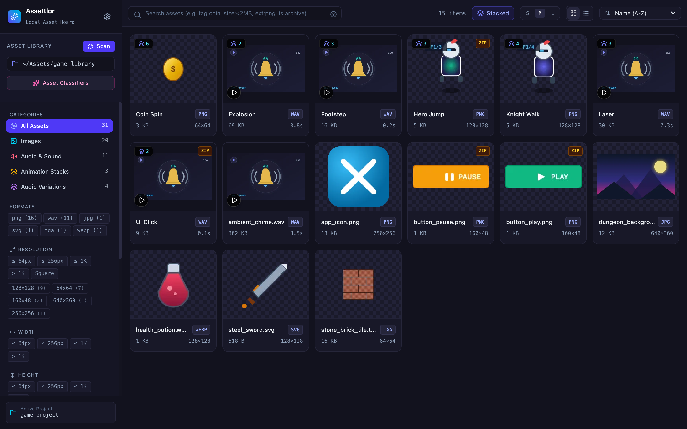
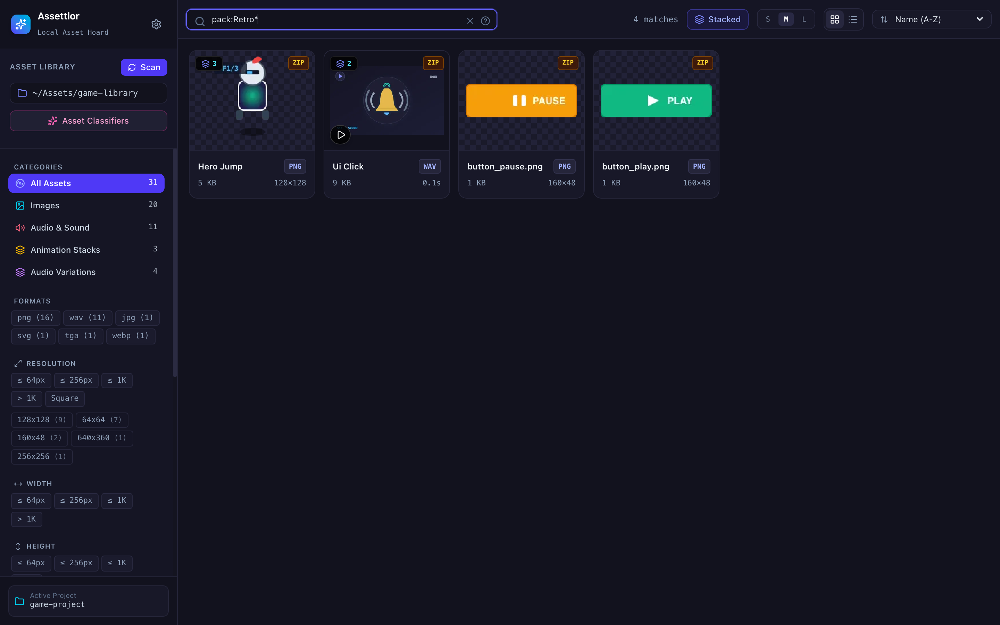
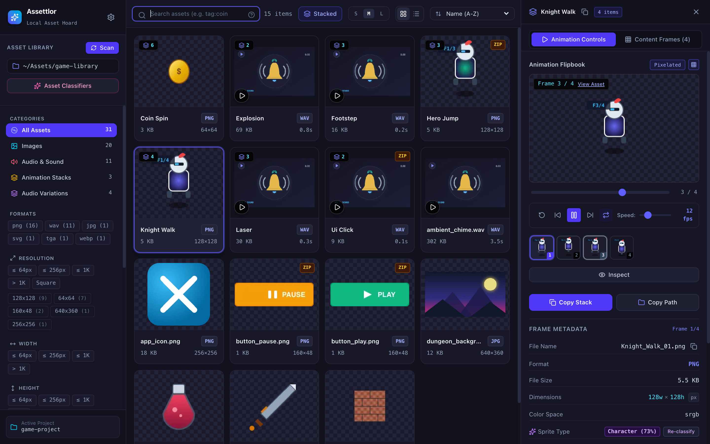
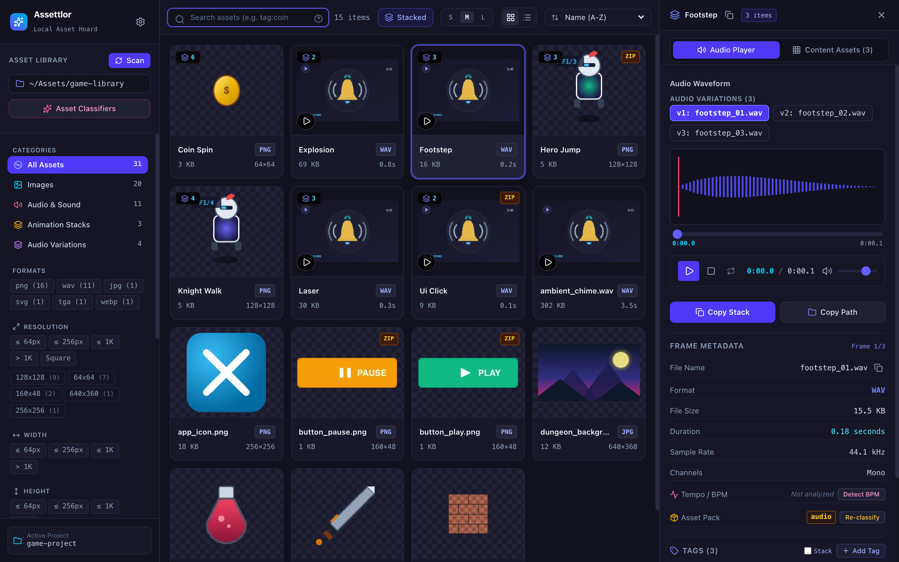
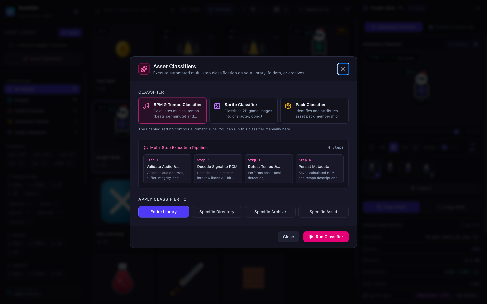
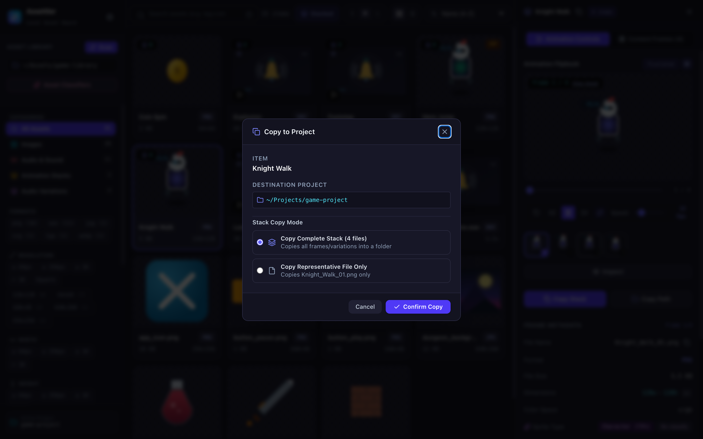

[Documentation home](index.md)

# Using Assettlor

## Scan and browse

Add one or more library directories in Settings. A scan reads supported disk
files and ZIP entries, extracts metadata, creates thumbnails, and updates the
SQLite catalog. Later scans check content fingerprints and avoid decoding
unchanged media. Offline roots and failed traversal scopes retain their
previously indexed assets until a successful scan can reconcile them.

Use category, tag, and format filters in the sidebar and search in the top bar.
The gallery offers stacked and flat views, sorting, and **Load more** paging.
To browse numbered pages of 100 results instead, set **Paging** to
**Numbered pages** under **Catalog Results** in Settings.
Open an asset to inspect its dimensions, audio metadata, tags, and source path.

## Search

| Example | Meaning |
|---|---|
| `tag:"pixel art"` | Match an exact tag |
| `pack:"Retro Pack"` | Match an exact pack name |
| `pack:retro*` | Match pack names with a wildcard |
| `tag:target AND bpm:fast` | Combine tag and tempo filters |

Quote names containing spaces, punctuation, or search operators. Inside quoted
values, escape `"` and `\` with a backslash. Unquoted `*` acts as a wildcard
only for `pack:` filters; `%` and `_` are literal characters.

Named BPM ranges are `slow` (below 80), `moderate` (80 to below 120), `fast`
(120 to below 150), and `high` or `very-fast` (150 or above).

In stacked view, separate filters can match different members of one stack.
For example, a stack can match `tag:target AND bpm:fast` when one member has
the tag and another has the tempo. In flat view, all filters must match the
same asset. Empty known filters such as `tag:` impose no restriction while
you type; unsupported clauses are searched as literal text.

## Preview stacks and media

Sequential image names such as `Logo_Spin_01.png` through `Logo_Spin_04.png`
can form an animation stack. Numbered or lettered audio variants such as
`click_01.wav` and `click_02.wav`, or `Chime_A.wav` and `Chime_B.wav`, can form
an audio variation stack.

The inspector includes a flipbook player with playback, a 1–60 FPS control,
and a frame scrubber. Audio previews use a waveform player and variant
selection. Image previews support zoom, pointer dragging, arrow-key panning,
and resetting the pan position. TGA images use converted thumbnails for display.

## Classify assets

The classifier interface exposes BPM analysis for audio, sprite classification
for images, and pack inference from archives or directories. Each classifier
has its own settings and can run against selected targets. Optional tag
application is controlled in classifier settings. See
[Configuration](configuration.md) for defaults and the [API reference](api.md)
for programmatic runs.

When an archive's file name is a hash (for example
`2f0f082ccb41c9900f43d2b54a16f1c84c5352e8.zip`), pack inference looks inside
it and uses its single root directory as the pack name, unless that directory
name is also a hash.

## Copy to a project

Configure a project destination in Settings and choose **Copy to Project**.
You can copy a single file, a stack's representative file, or all members of a
stack. A full stack goes into a dedicated folder, using its stack name when
no subfolder is supplied. ZIP entries are read from the archive and written
as regular files in the destination.

Copies check sources and destinations before writing. Existing files,
duplicate member names, and unsafe destination symlinks cause a conflict.
If a copy fails during execution, Assettlor attempts to remove the files
published by that operation and reports any remaining paths. The success
message identifies the directory containing the copied files.

